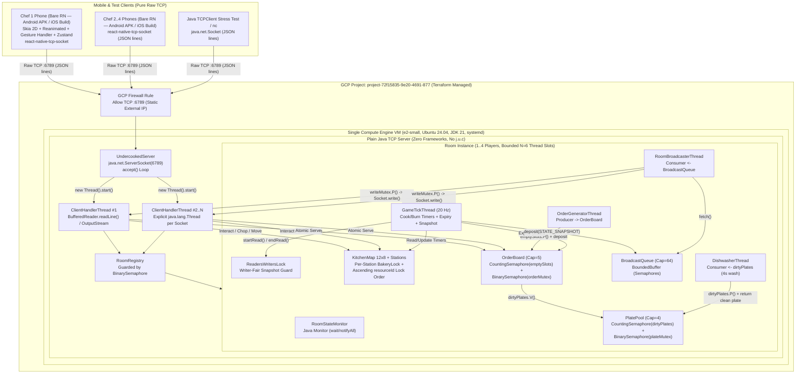
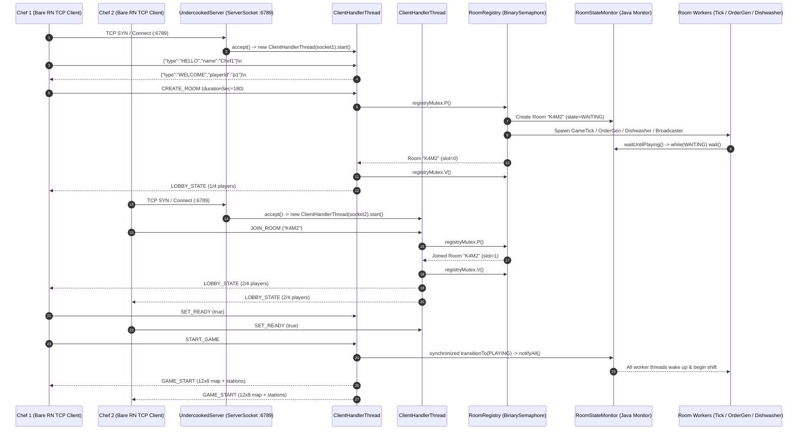
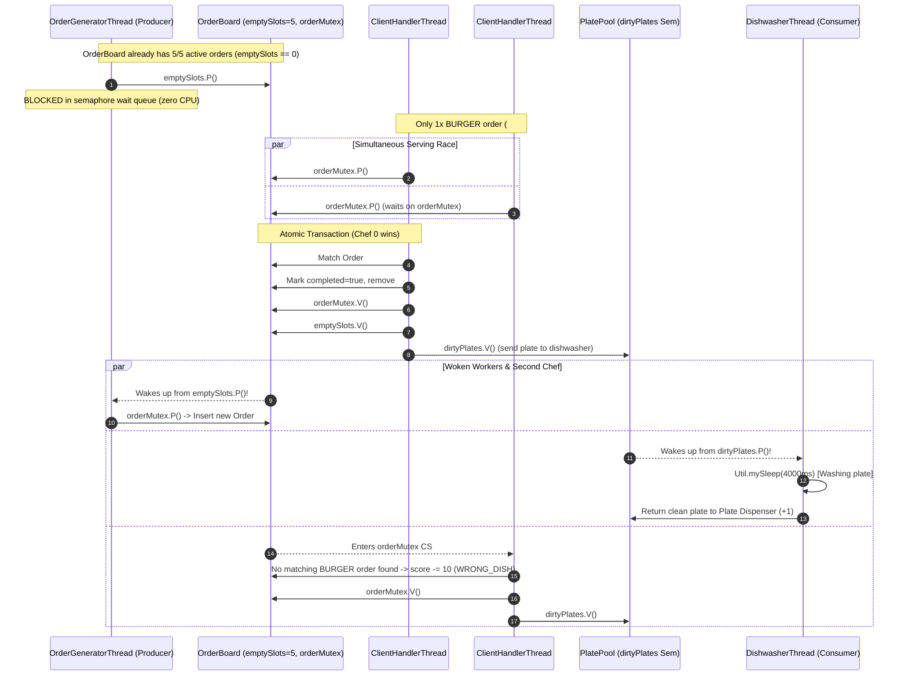
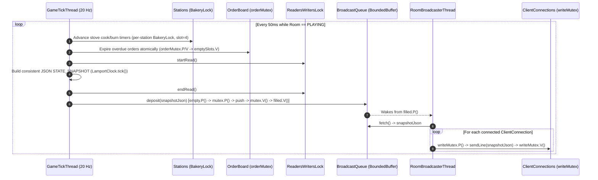

# ARCHITECTURE.md — Undercooked System & Sequence Diagrams

This document visualizes the overall architecture and core concurrent interaction flows of **Undercooked**.

---

## 1. Overall System Architecture



---

## 2. Sequence Diagram 1 — Raw TCP Connection, Room Join & Lobby Start (`RoomStateMonitor`)

Shows explicit `ServerSocket.accept()` thread creation (`lecture4-2.pdf`), newline-delimited TCP JSON messages, `RoomRegistry` mutual exclusion, and Java Monitor coordination waking room worker threads.



---

## 3. Sequence Diagram 2 — Contested Station Grab & Deadlock-Free Ordered Locking

Shows two chefs pressing `GRAB` on the exact same Stove `[S0]` holding a single `COOKED_PATTY`, protected by **Lamport's `BakeryLock`** and strict ascending **`resourceId` ordering** (`Player 0/1` < `Station 14`) to prevent item duplication and deadlock.

```mermaid
sequenceDiagram
    autonumber
    participant C1 as Chef 0 (Slot 0)
    participant C2 as Chef 1 (Slot 1)
    participant H1 as ClientHandlerThread #0
    participant H2 as ClientHandlerThread #1
    participant P0 as Player #0 (resId=0)
    participant P1 as Player #1 (resId=1)
    participant S0 as Stove #0 (resId=14, BakeryLock)

    Note over C1,C2: Stove #0 holds 1x COOKED_PATTY. Both chefs tap GRAB simultaneously.
    C1->>H1: INTERACT
    C2->>H2: INTERACT

    par Ordered Lock Acquisition (Player resId < Station resId)
        H1->>P0: BakeryLock.requestCS(slot=0)
        P0-->>H1: Acquired Player #0
        H1->>S0: BakeryLock.requestCS(slot=0) -> Ticket (1, 0)
    and
        H2->>P1: BakeryLock.requestCS(slot=1)
        P1-->>H2: Acquired Player #1
        H2->>S0: BakeryLock.requestCS(slot=1) -> Ticket (1, 1)
    end

    Note over S0: Tie-break: (1, 0) < (1, 1) -> Slot 0 enters CS first; Slot 1 waits (FIFO fair)
    S0-->>H1: Enter CS (Stove #0)
    H1->>S0: Read item == COOKED_PATTY -> Set Stove #0 item = null
    H1->>P0: Set Chef 0 heldItem = COOKED_PATTY
    H1->>S0: BakeryLock.releaseCS(slot=0) -> number[0] = 0
    H1->>P0: BakeryLock.releaseCS(slot=0)

    S0-->>H2: Enter CS (Stove #0)
    H2->>S0: Read item == null -> No-op (No duplication!)
    H2->>S0: BakeryLock.releaseCS(slot=1) -> number[1] = 0
    H2->>P1: BakeryLock.releaseCS(slot=1)
```

---

## 4. Sequence Diagram 3 — Producer–Consumer Orders, Atomic Serving & Dishwasher Pool

Shows:
1. `OrderGeneratorThread` blocking on `emptySlots.P()` when 5/5 orders are active.
2. Two chefs racing to serve the **only** matching `BURGER` order — atomic transaction prevents duplicate scoring.
3. `emptySlots.V()` waking `OrderGeneratorThread` and `dirtyPlates.V()` waking `DishwasherThread`.



---

## 5. Sequence Diagram 4 — 20 Hz Game Tick & Decoupled Broadcast Pipeline

Shows how `GameTickThread` advances stove/order timers, captures a consistent world snapshot via `ReadersWritersLock`, and hands it off to `RoomBroadcasterThread` through `BoundedBuffer` so slow TCP sockets never block simulation.


